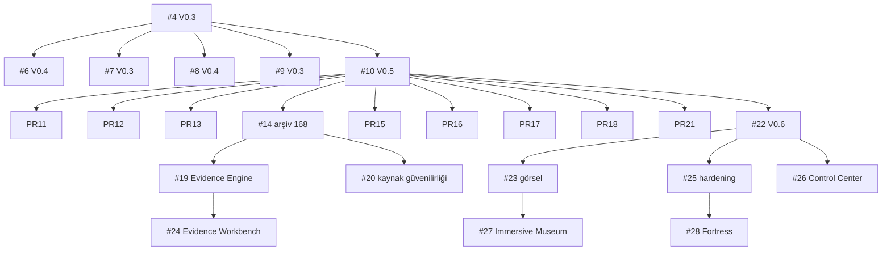

# PR bağımlılık grafiği

**Kenar türü (kesin):** B'nin taban dalı A'nın baş dalıysa A → B (`branch_base`). Açıklamadaki `#N` referansları yalnız **yumuşak kanıttır** (`explicitDependencies`); kesin bağımlılık sayılmaz. Makine okunur grafik: `reports/dependency-graph.mmd`.

- `main` tabanlı kökler: #1, #2, #3, #4, #5. Grafikte döngü yok; topolojik sıra hesaplandı.

## Kritik zincirler ve ön koşul ihlalleri (gerçek `plan` çıktısı)

| Zincir | Plan sonucu |
|---|---|
| `#27` tek başına | **BLOCKED**: ön koşul #23 ne dizide ne V0.6'da |
| `#24` tek başına | **BLOCKED**: ön koşul #19 ne dizide ne V0.6'da (#14 V0.6'da) |
| `#23 → #27` | OK |
| `#25 → #28` | OK |
| `#25,#23` ve `#23,#25` | OK (sıra bağımsız; aynı birleşik ağaç, `REHEARSAL-PLAN.md`) |
| `#25 → #28 → #26` | OK (metin düzeyinde; semantik sonuç için `REHEARSAL-PLAN.md`) |

## Taban farkı uyarısı

#19, #20 ve #24, #14'ün **dalına** dayanıyor; #14'ün kodu ise V0.6'da. Bu zincirler V0.6'ya taşınırken taban V0.6'ya yeniden hedeflenmeli (rebase veya retarget). Aksi hâlde PR diff'leri V0.5 → V0.6 farkını da içerir ve CI'ları V0.6'daki düzeltmeleri görmez (#19 örneği: `CI-GATES.md`).

## Belirsiz ilişkiler

- **#26 ↔ #28:** Git ilişkisi yok, ama semantik bağımlılık var. #28'in proxy'si `/yonetim` rotasını yanıtlıyor (`CONFLICT-MATRIX.md`).
- **#3:** İçeriği V0.6'da görünüyor ama farklı SHA ile (`content_equivalent_likely`).
