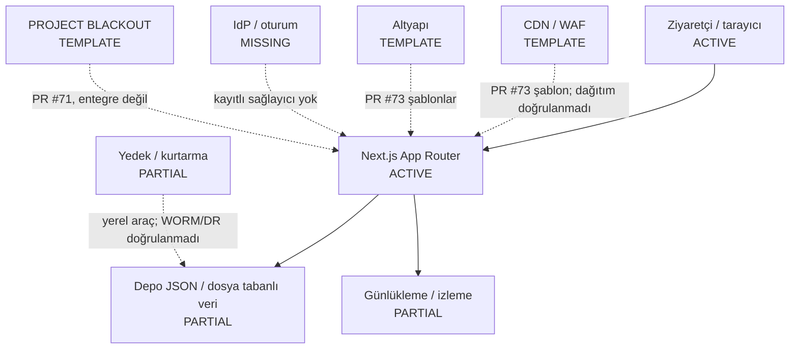

# Mevcut ve hedef güvenlik mimarisi

Değerlendirme tarihi: 2026-10-24. `ACTIVE` entegre kod kanıtıdır, üretim doğrulaması değildir. `TEMPLATE` açık PR kanıtı, `MISSING` mevcut olmayan katman, `NOT_VERIFIED` doğrulanamayan altyapı demektir.

| Katman | Durum | Bugünkü kanıt |
|---|---|---|
| Visitor | ACTIVE | Public read-only Next.js pages and a small set of GET routes are integrated. |
| CDN/WAF | TEMPLATE | Provider/WAF files are PR-only or unverified; no active edge deployment is confirmed. |
| Application | ACTIVE | Next.js App Router is integrated; admin paths fail closed and app routes are primarily read-only. |
| Infrastructure | TEMPLATE | Host, firewall, monitoring, and recovery configurations are proposed in open PR #73, not verified as deployed. |
| Identity | MISSING | No registered IdP; no live admin identity or session system. |
| Data integrity | PARTIAL | Repository integrity and backup tools exist; independent immutable anchoring is absent/unverified. |
| Monitoring | PARTIAL | Local logging/CI exist; centralized SIEM, WORM retention, and alert ownership are unverified. |
| BLACKOUT | TEMPLATE | Implementation is in open PR #71 only; no integrated or durable production state. |
| Backup/recovery | PARTIAL | Local backup tooling exists; immutable offline copies, independent recovery, and production drills are unverified. |

## Sınırlar

- Uygulama bugün Next.js tabanlı, ağırlıklı olarak herkese açık ve salt-okunur içerik sunar; veritabanı, canlı IdP ve yönetim oturumu doğrulanmamıştır.
- PR #71, #73 ve #74 açık kaldığı sürece bunların kodu, altyapısı veya test laboratuvarı entegre/aktif/üretim kanıtı değildir.
- Bu diagram üretim dağıtımı veya ağ keşfi iddiası taşımaz.
